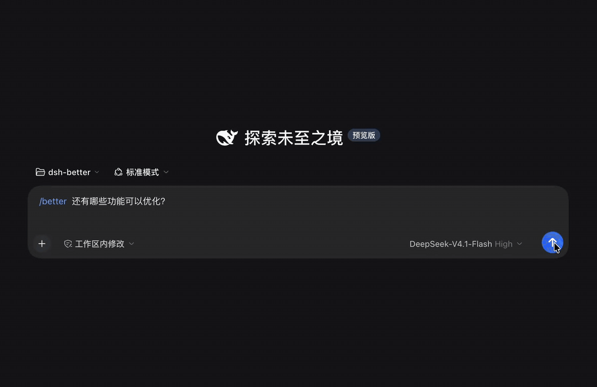

# Prompt Deepener (`dsh-better`)

`dsh-better` brings [`pi-better`](https://github.com/nicobailon/pi-better)'s codebase-grounded prompt deepening (`/better`) and subagent brief verification to DeepSeek Harness.

1. Run `/better <draft>` — the composer unlocks immediately while a read-only helper inspects your repository in the background.
2. Watch `Explore → Surface → Deepen → Sharpen` — live tool badges and streaming synthesis run in the Depth dock with KV cache reuse.
3. Review in the composer — the deepened prompt fills your draft box with one-click **Restore original**; nothing sends until you press `Enter`.

## Settings Reference (Adapted from `pi-better`)

In original `pi-better`, settings live under `"better"` with `model` and `thinking`. `dsh-better` supports full parity plus subagent controls:

| Setting | Default | Description |
| --- | --- | --- |
| `model` | `null` (inherit session) | Model route (`provider/model`) or routing group used by `/better`. Inheriting the active conversation model reuses its KV prompt cache; pinning a different model trades cache reuse for dedicated model quality or lower cost. |
| `reasoningEffort` | `null` (`low` fast default) | Equivalent to `pi-better`'s `thinking` setting (`none`, `off`, `low`, `medium`, `high`, `max`, or `inherit`). Defaults to fast `low` reasoning (clamping `high`/`max` chat efforts down to `low` while reusing KV cache) and matches supported model levels automatically. |
| `checkSubagents` | `true` | Enables or disables `/better` pre-dispatch verification on subagent prompts prefixed with `/better`. |
| `briefModel` | `null` (same as `model`) | Optional dedicated model override specifically for subagent `/better` brief checks. |
| `briefReasoningEffort` | `null` (same as `reasoningEffort`) | Optional dedicated reasoning effort override for subagent `/better` brief checks. |

## How to Configure in DeepSeek Harness

1. **Settings modal**: Open **Settings → Prompt Deepener** in the bottom-left settings menu (changes save automatically).
2. **Plugins page**: Open **Plugins → Prompt Deepener (`@agi-fans/dsh-better`)** (or configure row `@agi-fans/dsh-better#dsh-better`).
3. **Slash command (`/better-model`)**: Inspect or update settings directly from any chat or CLI session:
   - `/better-model` — show current settings and available models
   - `/better-model <provider/model> [effort]` — pin model and optional reasoning effort
   - `/better-model effort <level|inherit>` — update reasoning effort only
   - `/better-model brief <same|inherit|<provider/model>> [effort]` — configure subagent brief check model
   - `/better-model subagents <on|off>` — toggle subagent brief checking live
   - `/better-model reset [all]` — reset to session inheritance (or reset all fields)

GUI and `/better-model` changes persist atomically in the active profile's `dsh-better.settings.json` and take effect immediately without restarting. Baseline defaults live in `cordis.patch.yml`.
